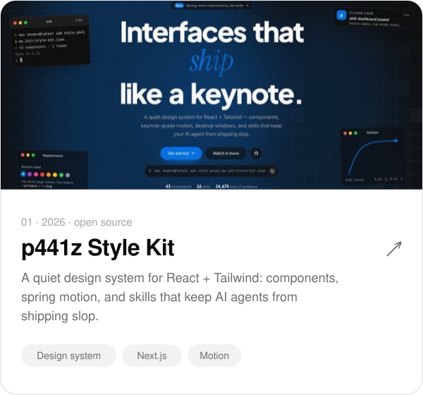
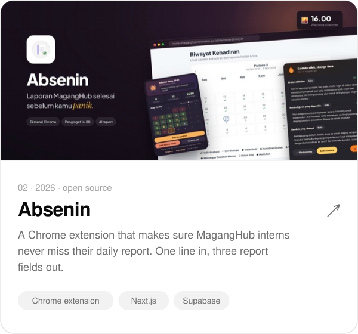
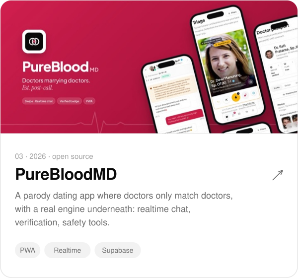
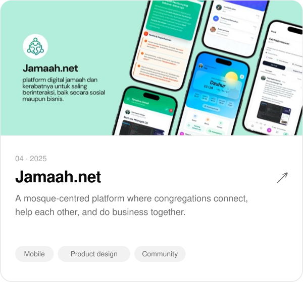
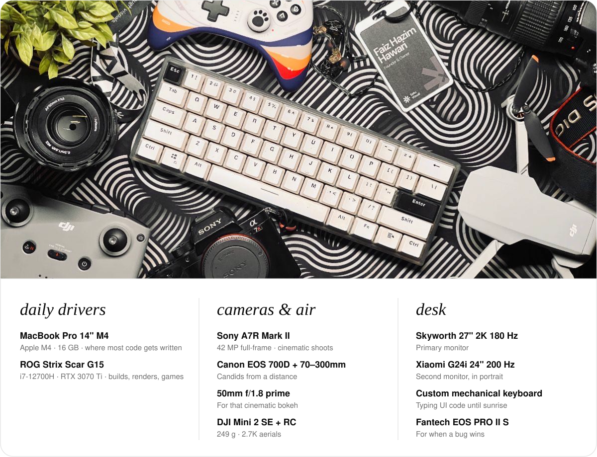
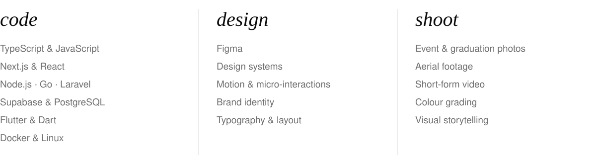
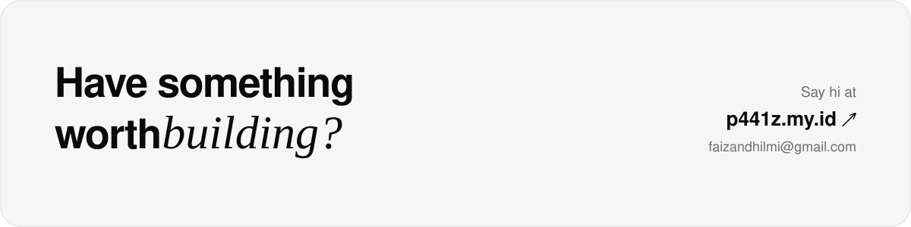

<a href="https://p441z.my.id">
  <picture>
    <source media="(prefers-color-scheme: dark)" srcset="assets/header-dark.svg">
    
  </picture>
</a>

  

Hi, I'm **Faiz**, online I go by **p441z**. I build products end to end: the interface, the API behind it, and the small bits of motion that make them feel finished. These days that means internal HR products by day and the [p441z Style Kit](https://style.p441z.my.id) by night. When I'm not shipping, I'm usually behind a camera.

 

<picture>
  <source media="(prefers-color-scheme: dark)" srcset="assets/h-work-dark.svg">
  
</picture>

  <a href="https://style.p441z.my.id"><picture><source media="(prefers-color-scheme: dark)" srcset="assets/work-style-kit-dark.svg"></picture></a>
  <a href="https://absenin.p441z.my.id"><picture><source media="(prefers-color-scheme: dark)" srcset="assets/work-absenin-dark.svg"></picture></a>

  <a href="https://purebloodmd.p441z.my.id"><picture><source media="(prefers-color-scheme: dark)" srcset="assets/work-purebloodmd-dark.svg"></picture></a>
  <a href="https://jamaahdotnet.id"><picture><source media="(prefers-color-scheme: dark)" srcset="assets/work-jamaah-dark.svg"></picture></a>

Source code: <a href="https://github.com/Zazaaw/p441z-style-kit">p441z-style-kit</a> · <a href="https://github.com/Zazaaw/absenin">absenin</a> · <a href="https://github.com/Zazaaw/PureBloodMD">PureBloodMD</a> &nbsp;—&nbsp; more on <a href="https://p441z.my.id/projects">p441z.my.id/projects</a>

  

<picture>
  <source media="(prefers-color-scheme: dark)" srcset="assets/h-gear-dark.svg">
  
</picture>

<a href="https://p441z.my.id/gear">
  <picture>
    <source media="(prefers-color-scheme: dark)" srcset="assets/gear-dark.svg">
    
  </picture>
</a>

  

<picture>
  <source media="(prefers-color-scheme: dark)" srcset="assets/h-github-dark.svg">
  
</picture>

<picture>
  <source media="(prefers-color-scheme: dark)" srcset="assets/activity-dark.svg">
  
</picture>

  

<picture>
  <source media="(prefers-color-scheme: dark)" srcset="assets/h-coding-dark.svg">
  
</picture>

<picture>
  <source media="(prefers-color-scheme: dark)" srcset="assets/coding-dark.svg">
  
</picture>

  

<picture>
  <source media="(prefers-color-scheme: dark)" srcset="assets/h-toolkit-dark.svg">
  
</picture>

<picture>
  <source media="(prefers-color-scheme: dark)" srcset="assets/toolkit-dark.svg">
  
</picture>

  

<a href="https://p441z.my.id/contacts">
  <picture>
    <source media="(prefers-color-scheme: dark)" srcset="assets/hello-dark.svg">
    
  </picture>
</a>

  <a href="https://p441z.my.id">Website</a> &nbsp;·&nbsp;
  <a href="https://www.linkedin.com/in/zazaaw/">LinkedIn</a> &nbsp;·&nbsp;
  <a href="https://www.instagram.com/faizhazimhawarii">Instagram</a> &nbsp;·&nbsp;
  <a href="mailto:faizandhilmi@gmail.com">Email</a>

